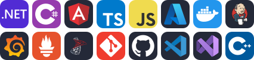
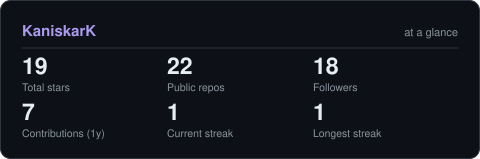

<!-- BANNER - terminal profile.sh --live. Generated with dark/light prefers-color-scheme -->
<picture>
  <source media="(prefers-color-scheme: dark)"  srcset="assets/banner-dark.v9.svg">
  <source media="(prefers-color-scheme: light)" srcset="assets/banner-light.v9.svg">
  
</picture>

 

<!-- NAME / TAGLINE - animated typing -->

 

<!-- SOCIALS & PROFILES -->
&nbsp;&nbsp;
&nbsp;&nbsp;
&nbsp;&nbsp;
&nbsp;&nbsp;
&nbsp;&nbsp;

 

---

## This is me :)

Hi, I'm **Kaniskar**, a Full-Stack .NET Developer and Cloud Engineer broadcasting from Chennai, India 🇮🇳.
I specialize in building secure, resilient enterprise web architectures and high-velocity automation pipelines.

- 🏢 **Full Stack Engineer at [Adrenalin eSystems (Polaris Group)](https://www.myadrenalin.com/)**: Developing mission-critical web applications with **.NET Core 8**, **.NET Framework**, and **Angular 18+ (Reactive Forms)**; leading the modernization of legacy ASP.NET Web Forms into modular, scalable micro-solutions.
- ⚡ **CI/CD & DevOps Automation**: Automated continuous integration and deployment pipelines using **Jenkins** and batch scripts, slashing release times by **50%** and manual overhead by **80%**.
- 📊 **Large-Scale Observability & Data Architecture**: Engineered data aggregation Windows services operating across **350+ enterprise Microsoft SQL Server (MSSQL) databases** with **Prometheus**, **Loki**, **Alloy**, and real-time **Grafana** operational dashboards.
- 🔐 **Security & Cloud Infrastructure**: Hardening endpoints using **Burp Suite**, implementing **SAML 2.0 / OAuth 2.0** authentication flows, and integrating **Azure Blob Storage** for high-volume document workflows.
- 🚤 **International Robotics & IoT Awards**:
  - **ROBOBOAT 2022 (RoboNation, USA)**: International award winner ($300 prize) for building an Autonomous Surface Water Vehicle with YOLOv4 and Python.
  - **Fast Starter Award**: Recognized by Adrenalin eSystems for rapid onboarding and immediate production impact.
  - **Electronic Wings & IdEEEas 2K21**: 2nd place for IoT sensory safety glove innovations.
- 🎓 **Education**: B.E in Computer Science & Engineering from **Bannari Amman Institute of Technology** (CGPA: **8.81** / 10).
- 📜 **Certifications**:
  - **Microsoft Certified: Azure Developer Associate (AZ-204)**
  - **Microsoft Certified: Azure Fundamentals (AZ-900)**
  - **AWS Machine Learning** (Coursera)

 

## my perfect stack

<picture>
  <source media="(prefers-color-scheme: dark)"  srcset="assets/techstack-dark.svg">
  <source media="(prefers-color-scheme: light)" srcset="assets/techstack-light.svg">
  
</picture>

---

## signals

<table>
<tr>
<td width="50%" align="center" valign="middle">

<!-- Self-rated radar - edit assets/skills.json, the workflow redraws it -->
<picture>
  <source media="(prefers-color-scheme: dark)"  srcset="assets/radar-dark.svg">
  <source media="(prefers-color-scheme: light)" srcset="assets/radar-light.svg">
  
</picture>

</td>
<td width="50%" align="center" valign="middle">

<!-- Hand-authored language stack radar - edit assets/langmix.json -->
<picture>
  <source media="(prefers-color-scheme: dark)"  srcset="assets/radar-langs-dark.svg">
  <source media="(prefers-color-scheme: light)" srcset="assets/radar-langs-light.svg">
  
</picture>

</td>
</tr>
</table>

---

## Numbers matter? ohhh yes.

<!-- Self-hosted stat card. Deliberately independent of public shared instances that suffer from rate-limits and downtime -->
<picture>
  <source media="(prefers-color-scheme: dark)"  srcset="assets/card-stats-dark.svg">
  <source media="(prefers-color-scheme: light)" srcset="assets/card-stats-light.svg">
  
</picture>

  

---

` Built with passion • @KaniskarK `

